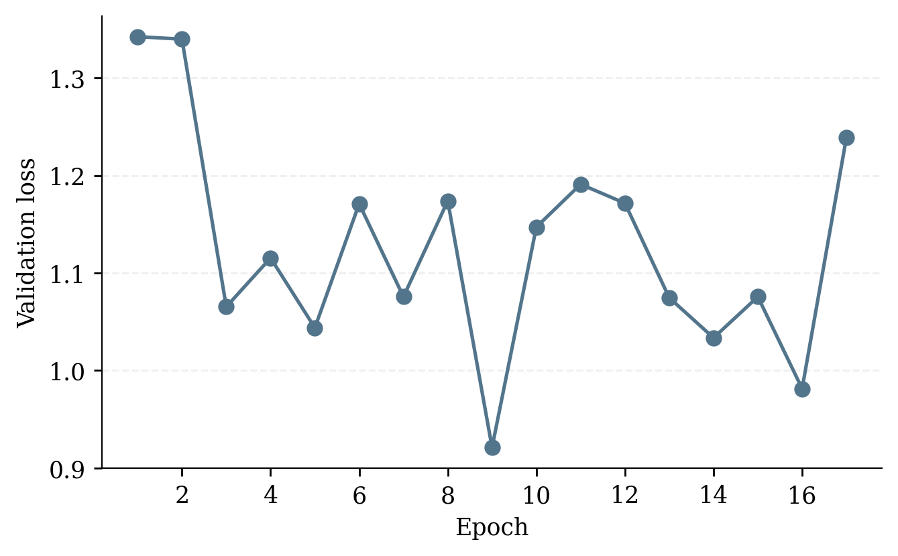
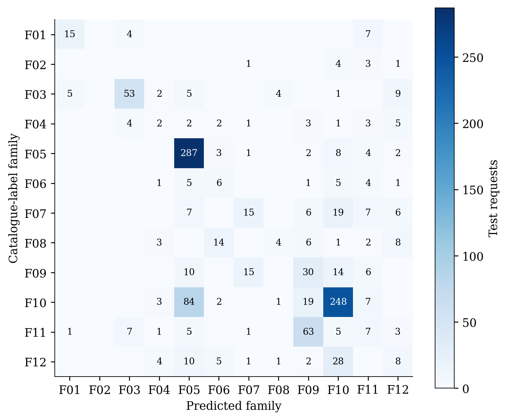
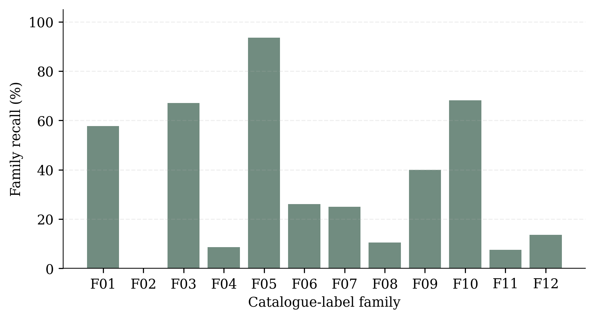

# AutoKeras best-trial validation

Date: 2026-11-09T13:10:23-03:00

Trial 020, selected by minimum validation loss across the completed AutoKeras study, stopped after 17 epochs with early stopping. Validation family accuracy was recomputed from the exported checkpoint. Only this selected trial is evaluated here. The best validation loss was 0.9209 at epoch 9, with 65.92% validation family accuracy. Only validation loss was saved per epoch, so no training-loss curve is inferred.

On 1,156 held-out requests, family accuracy is 58.39%, macro family recall is 34.82%, and parameter MAE is 9.24 nm among correct family predictions. Oracle-head MAE is 9.76 nm. Air substrate accuracy is 100%, but the dataset contains only air. The most common test label accounts for 31.49% of requests. Family labels are partition-specific minimax catalogue winners, so family accuracy alone does not establish absorption quality.

Five HFSS cases use seed 42 and distinct predicted families, without filtering by correctness. Exact predictions, requests, source rows and checkpoint/data hashes are in [predictions.json](predictions.json). This diversity sample is not a representative physical test estimate.

Physical solver status and spectra are recorded separately in `src/validation/inverse_design/autokeras/hfss_status.json` and [autokeras_hfss.md](autokeras_hfss.md) after simulation. Geometry values are used as predicted, without snapping to the catalogue.
