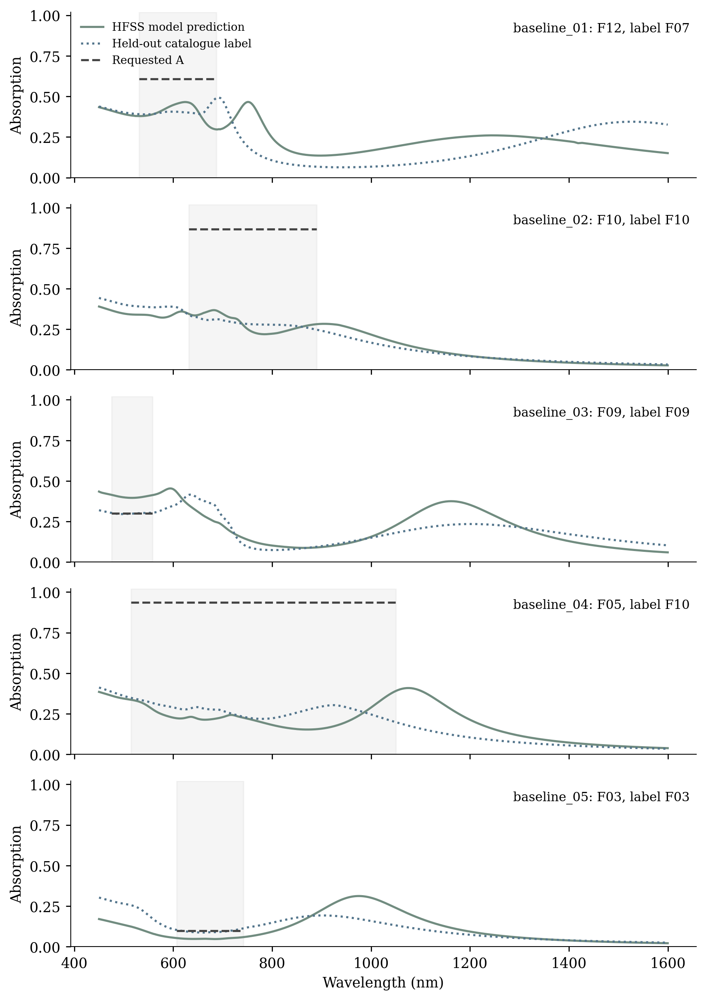
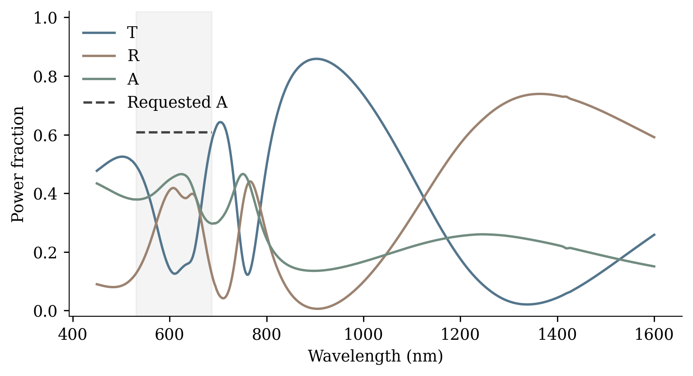
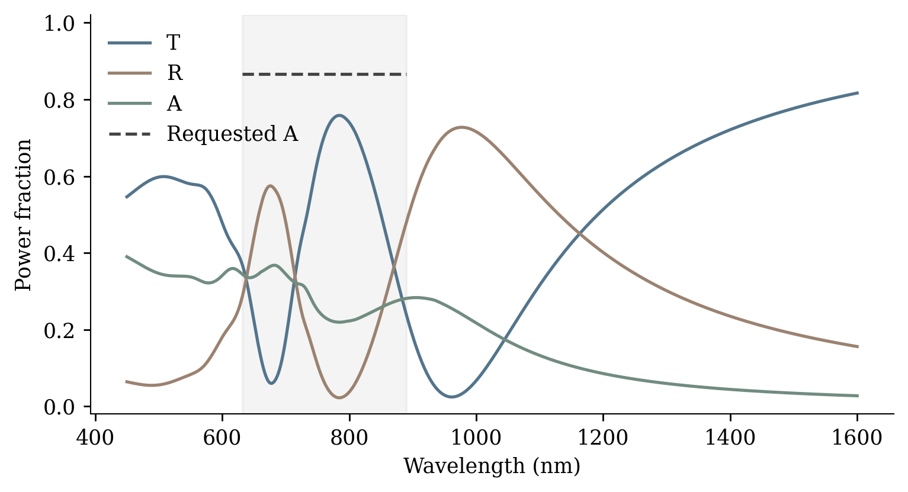
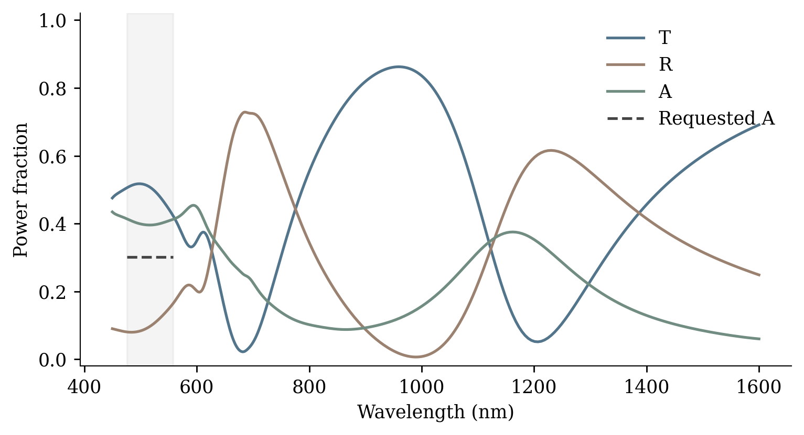
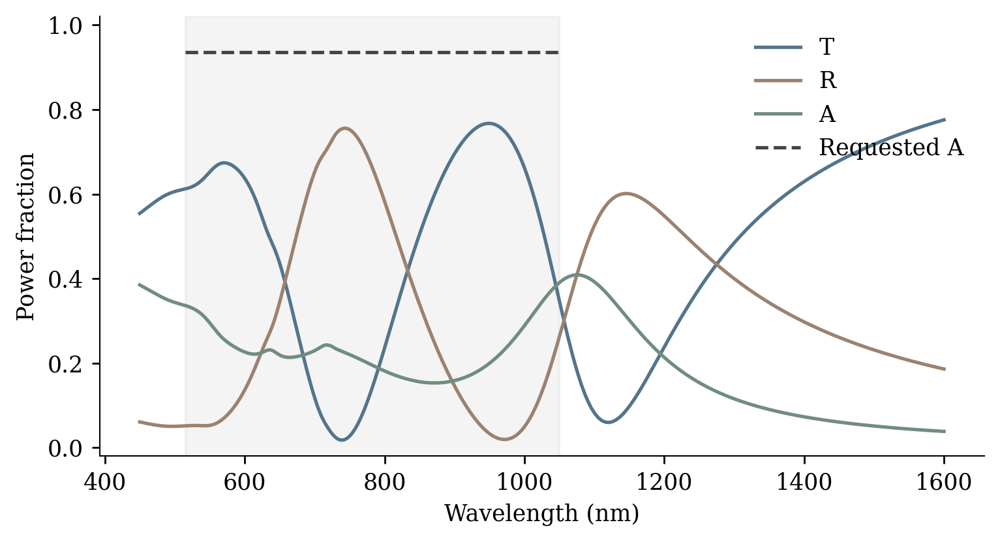
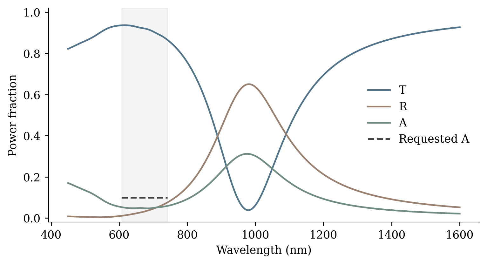

# Baseline HFSS results

Date: 2026-11-09T10:01:37-03:00

5/5 predicted geometries have exported 401-point HFSS spectra. The five separate AEDT projects remain open in the graphical desktop. Original received project and builder hashes were checked and are unchanged.

Cases are the first five distinct predicted families in a seed-42 shuffle of the test split. Predictions are used without clipping, rounding or catalogue snapping. The original 320 nm period, 30 nm gold, air, normal incidence, four Floquet modes per port, material dispersion, adaptive settings and frequency sweep are preserved. T/R/A are averaged over the two incident polarizations.

| Case | Family (predicted / label) | Worst error (pp) | Mean error (pp) | Catalogue worst (pp) | Mesh / sweep converged |
|---|---|---:|---:|---:|---|
| [baseline_01](baseline_01/baseline_01.aedt) | F12 / F07 | 31.17 | 20.53 | 21.93 | True / True |
| [baseline_02](baseline_02/baseline_02.aedt) | F10 / F10 | 64.69 | 58.18 | 61.86 | True / True |
| [baseline_03](baseline_03/baseline_03.aedt) | F09 / F09 | 11.30 | 10.10 | 0.53 | True / True |
| [baseline_04](baseline_04/baseline_04.aedt) | F05 / F10 | 78.26 | 70.80 | 73.71 | True / True |
| [baseline_05](baseline_05/baseline_05.aedt) | F03 / F03 | 5.18 | 4.86 | 1.45 | True / True |

Errors compare simulated absorption with the requested constant level inside its wavelength band. “pp” means percentage points. Mean error is weighted by wavelength. Catalogue error uses the original held-out label spectrum, not the predicted geometry. Small endpoint differences from the rounded dataset grid are interpolated within 0.002 nm. Five diverse cases do not establish performance across the entire test split, and no acceptance tolerance was specified.

Requests are objectives, not guarantees of physical feasibility. The catalogue reference also has target error, so the prediction error must be interpreted alongside that reference.

The largest difference between the two polarization transmission curves is 6.52 percentage points. Although the spectra are averaged as in the received generator, this discrepancy should be checked with a mesh/port convergence study before treating the curves as final physical validation.

Projects, spectra and native diagnostics: `src/validation/baseline/baseline_01/` through `baseline_05/`. Selection and checkpoint hashes: `predictions.json`. Full numerical comparison: `physical_summary.json`. Detailed runtime status: `hfss_status.json`.
