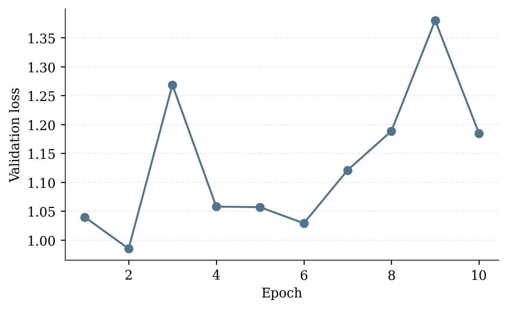
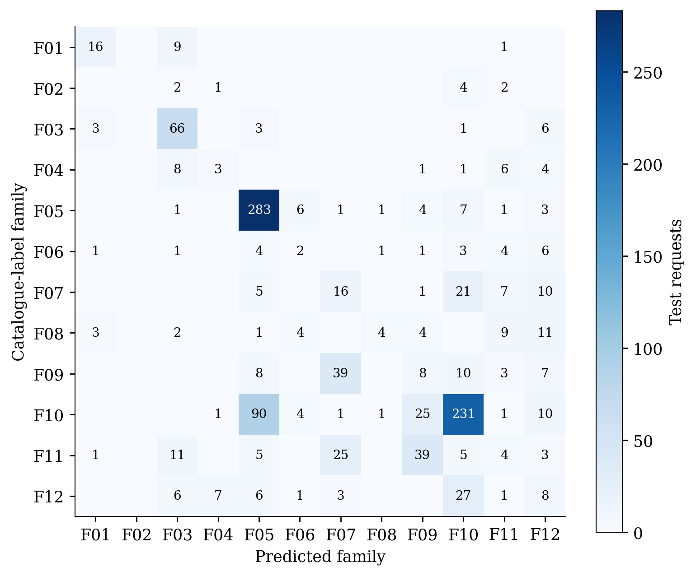
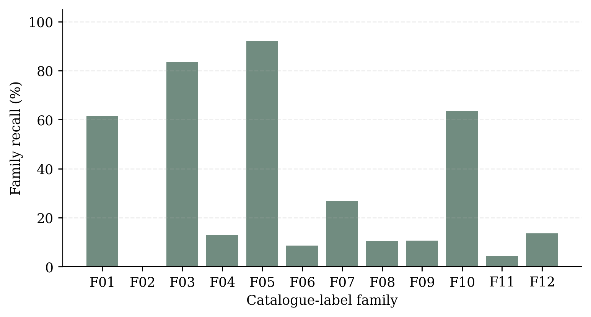

# Baseline validation

Date: 2026-11-09T10:06:32-03:00

The full baseline stopped after 10 epochs with early stopping. The best validation loss was 0.9849 at epoch 2, with 68.69% validation family accuracy. Only validation loss was saved per epoch, so no training-loss curve is inferred.

On 1,156 held-out requests, family accuracy is 55.45%, macro family recall is 32.35%, and parameter MAE is 10.35 nm among correct family predictions. Oracle-head MAE is 11.27 nm. Air substrate accuracy is 100%, but the dataset contains only air. The most common test label accounts for 31.49% of requests. Family labels are partition-specific minimax catalogue winners, so family accuracy alone does not establish absorption quality.

Five HFSS cases use seed 42 and distinct predicted families, without filtering by correctness. Exact predictions, requests, source rows and checkpoint/data hashes are in [predictions.json](predictions.json). This diversity sample is not a representative physical test estimate.

Physical solver status and spectra are recorded separately in `src/validation/baseline/hfss_status.json` and [baseline_hfss.md](baseline_hfss.md) after simulation. Geometry values are used as predicted, without snapping to the catalogue.
