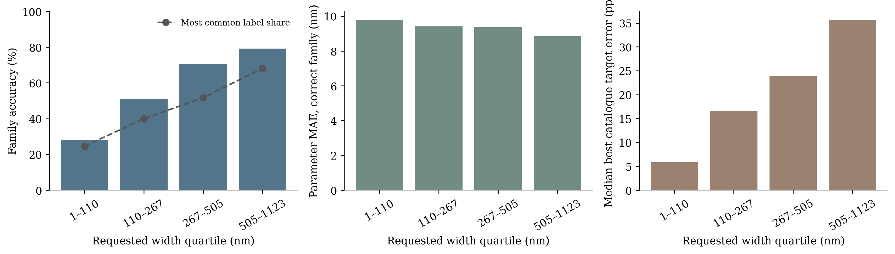
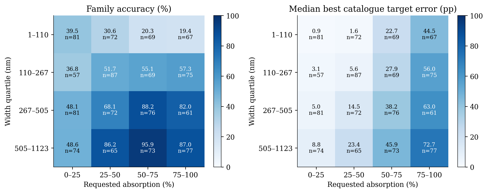
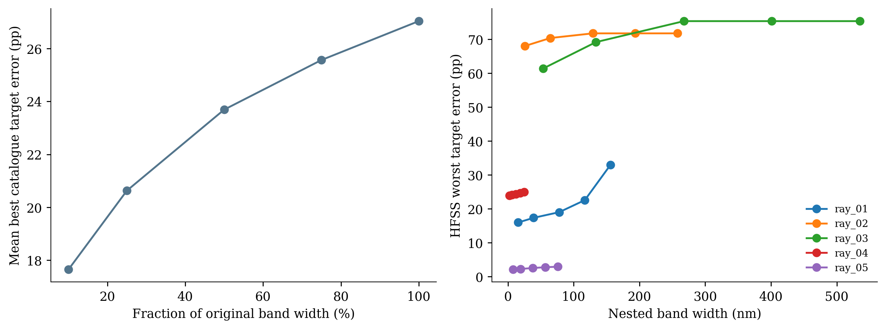

# Ray bandwidth analysis

Date: 2026-11-09T13:04:09-03:00

Analyzed all 1,156 retained test requests. Width means band end minus band start. Width quartile groups retain equal widths together, so counts can differ slightly. Parameter MAE uses active parameters only, among correct family predictions. Catalogue error is the best received test-catalogue spectrum error, not simulated model output.

| Width (nm) | Requests | Family accuracy | Majority-label share | Correct-family MAE (nm) | Median best catalogue error (pp) |
|---|---:|---:|---:|---:|---:|
| 1–110 | 289 | 28.03% | 24.57% | 9.79 | 5.85 |
| 110–267 | 288 | 51.04% | 39.93% | 9.41 | 16.65 |
| 267–505 | 290 | 70.69% | 51.72% | 9.36 | 23.84 |
| 505–1123 | 289 | 79.24% | 68.17% | 8.85 | 35.64 |

The two-dimensional plot separates requested absorption into four levels, with counts shown. These are descriptive associations. Band center, family mix and parameter difficulty also differ between groups, so wider-band classification accuracy does not measure physical feasibility.

A paired catalogue check shrank each original test band to 10%, 25%, 50%, 75% and 100% of its wavelength span, keeping the exact wavelength center and target fixed. Spectrum endpoints were linearly interpolated. Each band was optimized over all received test-partition spectra. Across nested bands, the best achievable catalogue worst error cannot decrease with width. Mean best error rose from 17.65 to 27.03 pp. This is catalogue-limited evidence, not a bound over all possible geometries. No model was evaluated on synthetic relabeled requests.

For each of the five existing HFSS spectra, the nested-band check kept geometry, band center and absorption target fixed. The error curves use the already solved spectra, with linear endpoint interpolation. No new solver run or retraining was performed. Five diversity-selected cases do not estimate physical accuracy over the entire test split.

A wider nested band adds constraints, so its worst absolute target error cannot improve for a fixed geometry. Higher absorption targets can still dominate the difficulty, even on narrow bands. This monotonic statement applies to worst error, not necessarily wavelength-averaged error.

Detailed numbers: [bandwidth_analysis.json](bandwidth_analysis.json). All test-request diagnostics: [bandwidth_requests.csv](bandwidth_requests.csv). Source hashes, retained arrays and the full-band catalogue optimum were checked. No predicted geometry was replaced by a nearby catalogue geometry.

| HFSS case | Full width (nm) | Target A | Worst error at 10% width (pp) | Worst error at full width (pp) |
|---|---:|---:|---:|---:|
| ray_01 | 155.9 | 60.84% | 15.96 | 32.94 |
| ray_02 | 258.0 | 86.62% | 68.01 | 71.74 |
| ray_03 | 535.1 | 93.57% | 61.36 | 75.34 |
| ray_04 | 24.6 | 69.50% | 23.93 | 24.92 |
| ray_05 | 75.8 | 18.18% | 2.07 | 2.91 |

Family accuracy changes from 28.03% in the narrowest group to 79.24% in the widest, while median best catalogue target error rises from 5.85 to 35.64 pp. Broad-band label prediction is easier here despite worse physical target matching. The majority-label shares and absorption strata help interpret this distinction.
