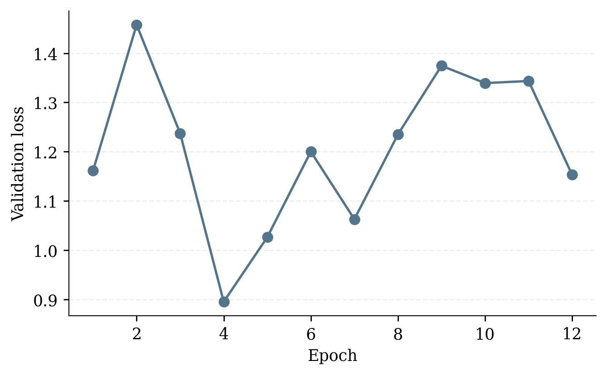
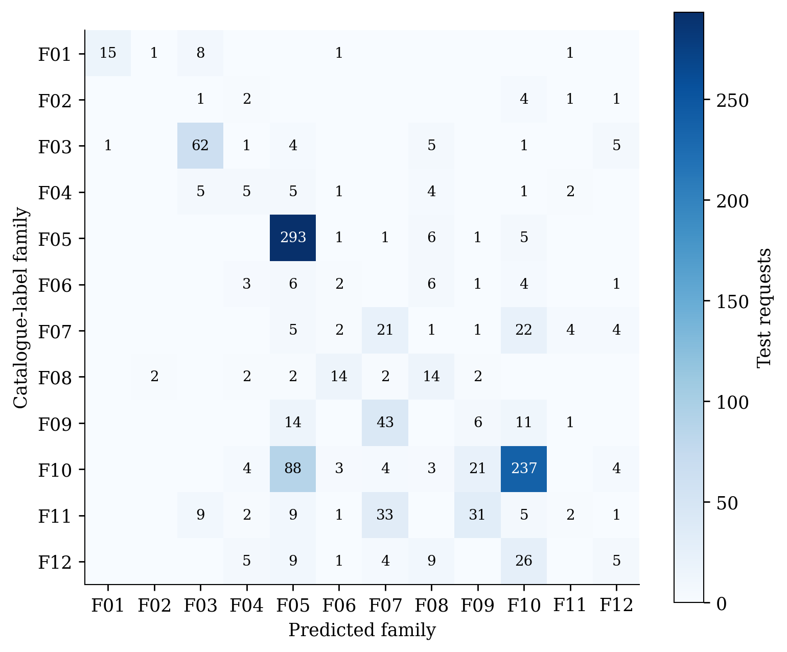
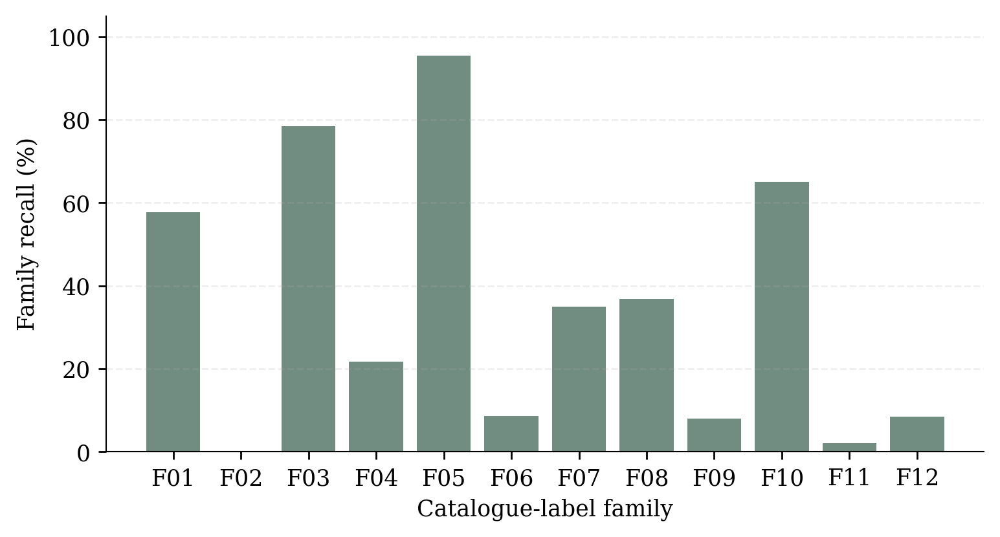

# Ray best-trial validation

Date: 2026-11-09T11:39:06-03:00

Candidate `candidate_63ea3_00006_6_activation=silu,depth=5,dropout=0.3000,width=256_2026-11-09_10-09-36`, selected by minimum validation loss across the completed Ray search, stopped after 12 epochs with early stopping. Only this selected trial is evaluated here. The best validation loss was 0.8953 at epoch 4, with 70.33% validation family accuracy. Only validation loss was saved per epoch, so no training-loss curve is inferred.

On 1,156 held-out requests, family accuracy is 57.27%, macro family recall is 34.80%, and parameter MAE is 9.24 nm among correct family predictions. Oracle-head MAE is 10.14 nm. Air substrate accuracy is 100%, but the dataset contains only air. The most common test label accounts for 31.49% of requests. Family labels are partition-specific minimax catalogue winners, so family accuracy alone does not establish absorption quality.

Five HFSS cases use seed 42 and distinct predicted families, without filtering by correctness. Exact predictions, requests, source rows and checkpoint/data hashes are in [predictions.json](predictions.json). This diversity sample is not a representative physical test estimate.

Physical solver status and spectra are recorded separately in `src/validation/ray/hfss_status.json` and [ray_hfss.md](ray_hfss.md) after simulation. Geometry values are used as predicted, without snapping to the catalogue.
