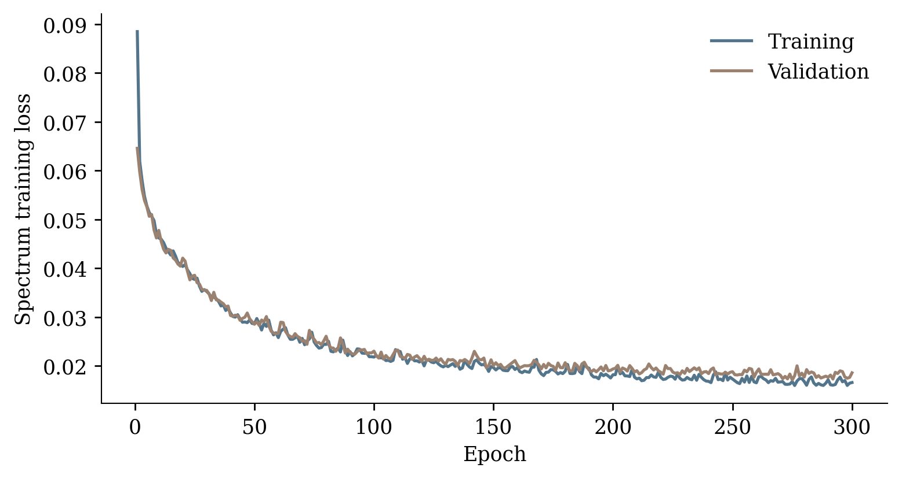
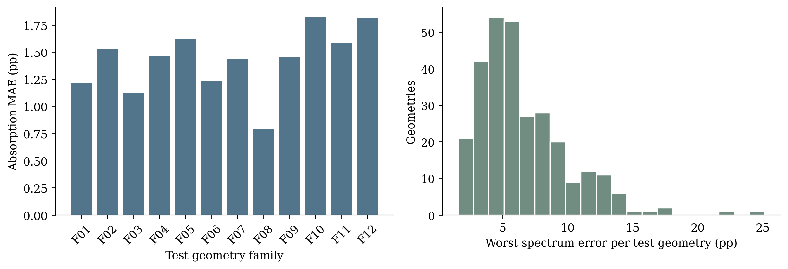
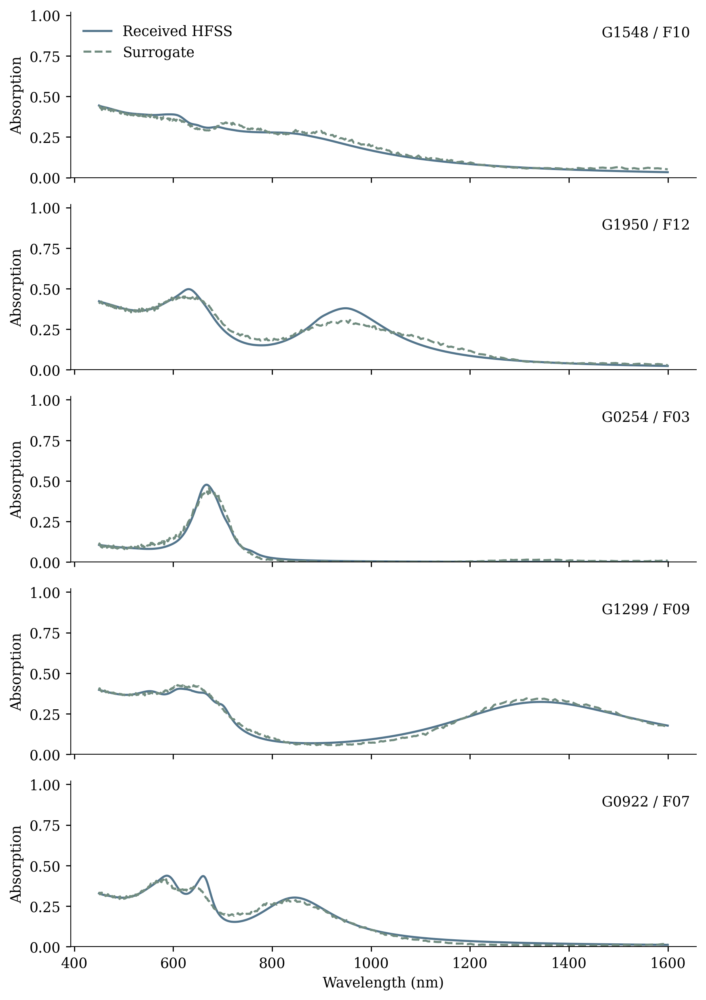

# Flat AutoKeras validation

Date: 2026-11-10T10:42:14-03:00

AutoKeras selected trial 032 by validation loss. The selected trial completed 300 epochs on 1348 training geometries. Lowest recorded validation loss occurred at epoch 275. The selected checkpoint was verified against its retained dataset.

On all 289 held-out geometries, absorption MAE is **1.446 pp**. Mean worst spectrum error is **6.518 pp**, and the 95th percentile is **13.024 pp**. These describe forward-spectrum fidelity, not flat-target success.

Five design requests preserve the exact wavelength bands and absorption levels used in the previous inverse baseline. Each is optimized with training-only starts/bounds, and the best predicted candidate is selected by worst target error. These fixed cases are not a representative physical test estimate. The observed catalogue reference is selected only from training geometries.

| Case | Band (nm) | Target A | Chosen family | Predicted worst error (pp) |
|---|---|---:|---|---:|
| flat_autokeras_01 | 531.1–687.0 | 60.84% | F12 | 20.320 |
| flat_autokeras_02 | 631.6–889.5 | 86.62% | F10 | 55.178 |
| flat_autokeras_03 | 475.6–558.4 | 30.12% | F09 | 0.851 |
| flat_autokeras_04 | 514.7–1049.9 | 93.57% | F05 | 70.736 |
| flat_autokeras_05 | 607.1–742.0 | 9.86% | F03 | 1.844 |

The geometric designs and their absorption values above are surrogate predictions. Actual HFSS spectra and target errors are reported separately after simulation in [autokeras_hfss.md](autokeras_hfss.md). Detailed metrics: [spectrum_metrics.json](spectrum_metrics.json). Cases and hashes: [predictions.json](predictions.json). Per-test-geometry errors: [test_geometry_errors.csv](test_geometry_errors.csv).
