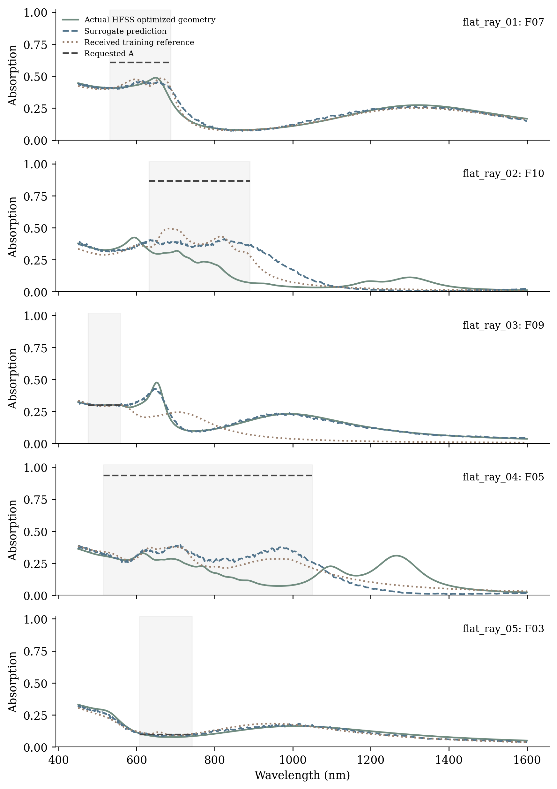
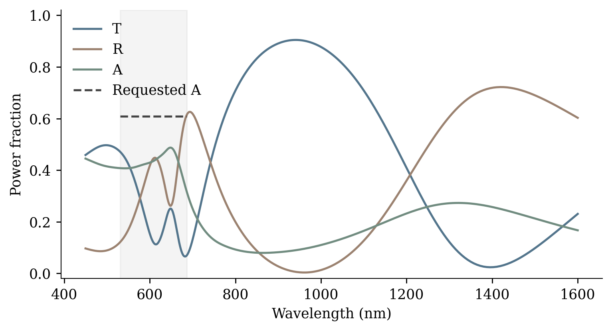
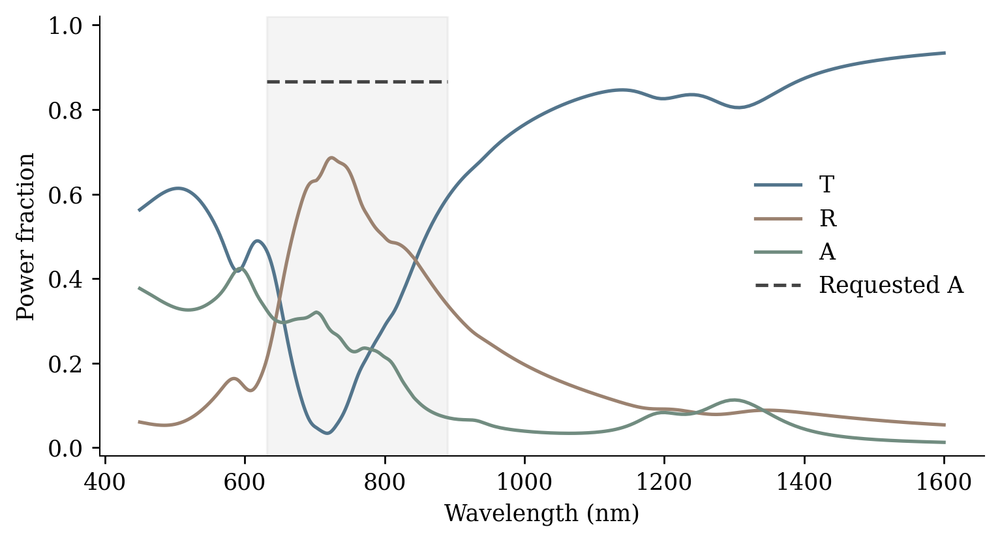
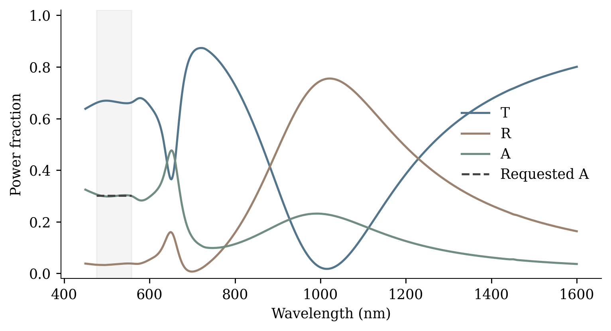
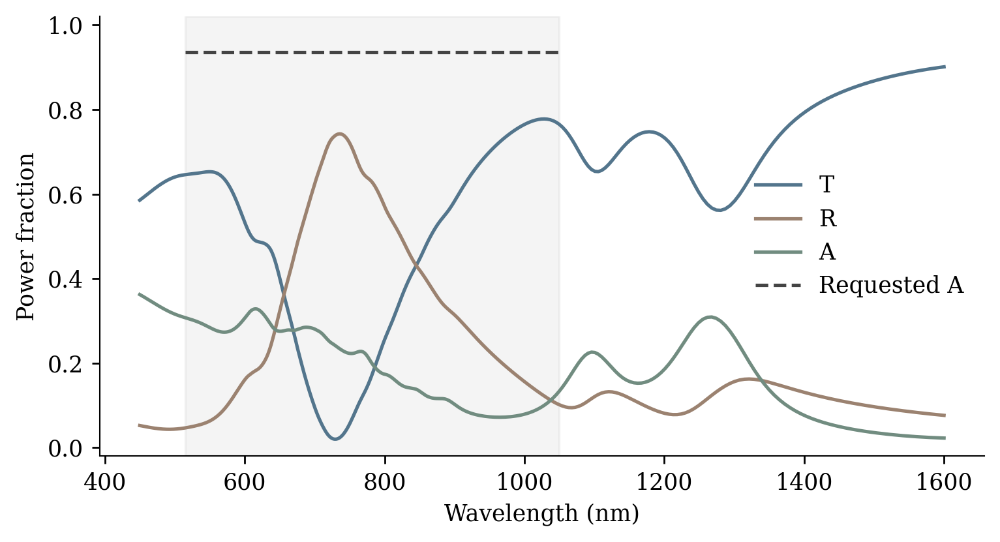
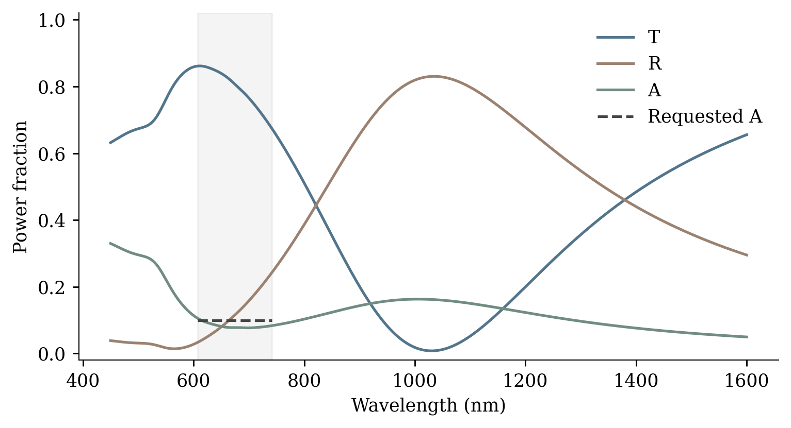

# Flat Ray HFSS validation

Date: 2026-11-10T10:42:10-03:00

5/5 optimized geometries have actual 401-point HFSS spectra. Original project and builder hashes were verified. The same five target requests as the earlier inverse baseline are used for paired comparison. Each new geometry was optimized with the trained flat-spectrum Ray winner, using only training starts and bounds.

| Project | Family | Predicted worst (pp) | HFSS worst (pp) | HFSS mean (pp) | Earlier inverse worst (pp) | Mesh / sweep converged |
|---|---|---:|---:|---:|---:|---|
| [flat_ray_01](flat_ray_01/flat_ray_01.aedt) | F07 | 21.17 | 29.47 | 18.03 | 31.17 | True / True |
| [flat_ray_02](flat_ray_02/flat_ray_02.aedt) | F10 | 51.92 | 79.51 | 64.28 | 64.69 | True / True |
| [flat_ray_03](flat_ray_03/flat_ray_03.aedt) | F09 | 0.81 | 0.50 | 0.17 | 11.30 | True / True |
| [flat_ray_04](flat_ray_04/flat_ray_04.aedt) | F05 | 67.79 | 86.38 | 74.32 | 78.26 | True / True |
| [flat_ray_05](flat_ray_05/flat_ray_05.aedt) | F03 | 1.62 | 2.19 | 1.64 | 5.18 | True / True |

Errors measure deviation from the requested constant absorption inside its band. “pp” means percentage points. Mean errors are wavelength-weighted. Geometry values are used as optimized, without catalogue snapping. The original 320 nm cell, 30 nm gold, air, material dispersion, normal incidence, four Floquet modes per port and original adaptive/interpolating sweep settings are preserved. Spectra average the two incident polarizations.

2/5 cases meet ±5 pp across the full requested band. 3/5 have lower worst target error than the earlier inverse baseline on the identical request. These are five fixed examples, not a test-set-wide success estimate.

The largest two-polarization transmission difference is 36.27 pp. Converged solver status does not remove the need for mesh/port convergence studies before final physical acceptance.

High absorption objectives can remain far from the spectra available in the received catalogue. Low forward-spectrum test MAE does not guarantee that optimized geometries satisfy the requested target. Native solver convergence and surrogate optimism are recorded per case.

Full metrics and checkpoint hashes: [ray_validation.md](ray_validation.md). Solver status: [hfss_status.json](hfss_status.json). Physical comparison: [physical_summary.json](physical_summary.json).
